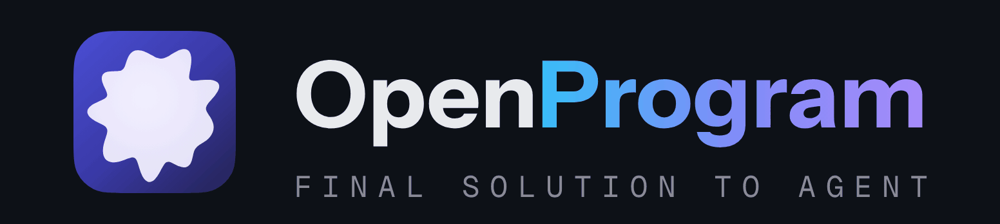

<p align="center">
  <picture>
    <source media="(prefers-color-scheme: dark)" srcset="docs/images/logo-lockup.gif">
    <source media="(prefers-color-scheme: light)" srcset="docs/images/logo-lockup-light.gif">
    
  </picture>
</p>

<!-- Compatibility anchors for existing incoming links. -->
<a id="1-agentic-function-the-primitive-everything-else-is-built-on"></a>
<a id="2-dag-context-for-native-multi-agent-systems"></a>
<a id="3-agentic-workflow-for-trustworthy-self-evolving-agents"></a>
<a id="4-event-infrastructure-for-proactive-agents"></a>
<a id="integrated-projects"></a>
<a id="why-openprogram"></a>
<a id="1-agentic-function--the-primitive-everything-else-is-built-on"></a>
<a id="2-dag-context--for-native-multi-agent-systems"></a>
<a id="3-agentic-workflow--for-trustworthy--self-evolving-agents"></a>
<a id="4-event-infrastructure--for-proactive-agents"></a>
<a id="also-in-the-product"></a>

<p align="center"><b>Un harness d’agents open source où les agents sont des programmes Python qui s’améliorent eux-mêmes.</b></p>

<p align="center">
  <a href="https://github.com/FuzzyKuji/OpenProgram/blob/main/.github/CHANGELOG.md"></a>
  <a href="https://github.com/FuzzyKuji/OpenProgram/blob/main/LICENSE"></a>
  <a href="https://www.python.org/"></a>
  
</p>

<p align="center">
  <a href="https://openprogram.io">Site web</a> · <a href="#install">Installation</a> · <a href="https://openprogram.io/docs/">Documentation</a>
</p>

<p align="center">
  <a href="README.md">English</a> · <a href="README.zh.md">简体中文</a> · <a href="README.zh-Hant.md">繁體中文</a> · <a href="README.ja.md">日本語</a> · <a href="README.ko.md">한국어</a> · <a href="README.es.md">Español</a> · <a href="README.fr.md">Français</a> · <a href="README.de.md">Deutsch</a> · <a href="README.pt-BR.md">Português</a> · <a href="README.ru.md">Русский</a>
</p>

- **Les agents sont des classes Python.** Flux de contrôle, vérifications et nouvelles tentatives sont du code ordinaire ; `self(...)` est un appel au modèle.
- **Auto-programmation.** Les agents écrivent de nouvelles méthodes dans leur propre classe, qui deviennent des outils dès le tour suivant.
- **Contexte en graphe.** Chaque appel est un nœud d’un même DAG ; les sous-agents travaillent sur leur propre branche et ne renvoient que leur résultat.
- **Un seul espace de travail.** Chat, fichiers, terminal et un navigateur intégré que l’agent peut piloter, côte à côte.
- **N’importe quel modèle.** Anthropic, OpenAI, Gemini et serveurs locaux, avec plusieurs comptes par fournisseur.

<a id="install"></a>

## Installation

```bash
curl -fsSL https://openprogram.io/install | sh
```

Sous Windows (à partir de v1.1.0) : `irm https://openprogram.io/install.ps1 | iex`. L’App de bureau macOS est un DMG disponible sur la [page des versions](https://github.com/FuzzyKuji/OpenProgram/releases) ; les Apps Linux et Windows arrivent avec v1.1.0. Si openprogram.io ne répond pas : `curl -fsSL https://raw.githubusercontent.com/FuzzyKuji/OpenProgram/main/docs/_static_root/install.sh | sh`. Plus d’options dans le [guide d’installation](https://openprogram.io/docs/install/install.html) (en anglais).

## Démarrage rapide

```bash
openprogram        # assistant de configuration, puis chat dans le terminal
openprogram web    # espace de travail sur http://localhost:18100
```

Ensuite : [premiers pas](docs/start/GETTING_STARTED.html) · [modèles](docs/models/README.html) · [toute la documentation](docs/README.html) (en anglais)

## En un coup d’œil

```python
from openprogram import Agent

class SupportAgent(Agent):
    def triage(self, ticket: str) -> str:
        """Classify the ticket, then draft a reply."""
        kind = self(ticket, choices=["bug", "question"])
        if kind == "bug":
            logs = search_logs(ticket)  # votre propre fonction utilitaire
            return self(f"Reply using:\n{logs}")
        return self("Draft a short reply.")
```

Le modèle décide ; Python garantit que les étapes nécessaires s’exécutent. Voir [écrire des agents](docs/capabilities/agentic-programming/writing-functions/agent.html) (en anglais).

## Fonctionnalités

Chaque entrée renvoie vers son document de conception (en anglais).

### Framework

| | |
|---|---|
| **[Classes d’agents](https://openprogram.io/docs/reference/design/function/agentic-program.html)** | Un agent est une classe Python ; branches, nouvelles tentatives et vérifications sont du code, `self(...)` est un appel au modèle. |
| **[DAG d’exécution](https://openprogram.io/docs/reference/design/runtime/dag/overview.html)** | Chaque tour utilisateur, appel au modèle et appel de fonction est un nœud que vous pouvez inspecter, ramifier et rejouer. |
| **[Contexte](https://openprogram.io/docs/reference/design/context/overview.html)** | Chaque appel lit une sélection de nœuds plutôt qu’un historique qui s’allonge, avec compaction automatique. |
| **[Auto-programmation](https://openprogram.io/docs/reference/design/runtime/workflows/workflow.html)** | Les agents écrivent de nouvelles méthodes dans leur propre classe ; elles deviennent des outils au tour suivant. |
| **[Décisions vérifiées](https://openprogram.io/docs/reference/design/runtime/execution/next-step-decision.html)** | Le modèle choisit dans un menu fixe et le code valide le choix avant toute exécution. |
| **[Sous-agents](https://openprogram.io/docs/reference/design/runtime/collaboration/agent-collaboration.html)** | Les sous-agents travaillent sur leur propre branche, éventuellement dans un worktree Git, et ne renvoient que leur résultat. |
| **[Événements](https://openprogram.io/docs/reference/design/proactive/event-layer.html)** | Un bus d’événements typé ; les plugins observent les événements ou filtrent les appels d’outils. |
| **[Agents permanents](https://openprogram.io/docs/reference/design/runtime/always-on-agents.html)** | Des agents qui tournent en arrière-plan et réagissent aux événements. |
| **[Objectifs et reprise](https://openprogram.io/docs/reference/design/runtime/reliability/goal-and-recovery.html)** | Les objectifs de longue durée survivent aux redémarrages et reprennent là où ils s’étaient arrêtés. |
| **[Tolérance aux pannes](https://openprogram.io/docs/reference/design/providers/reliability/llm-fault-tolerance.html)** | Nouvelles tentatives, délais d’expiration et classification des erreurs pour chaque appel au modèle. |

### Espace de travail

| | |
|---|---|
| **[Bureau et interface web](https://openprogram.io/docs/reference/design/ui/README.html)** | L’App sur macOS, et à partir de v1.1.0 sur Linux et Windows ; l’interface web sur chacun d’eux ou sur un serveur. |
| **[Panneaux partagés](https://openprogram.io/docs/reference/design/ui/workspace/center-tabs-and-split-layout.html)** | Chats, fichiers, terminaux et pages web côte à côte. |
| **[Navigateur intégré](https://openprogram.io/docs/reference/design/ui/browser/built-in-browser.html)** | Un navigateur que l’agent lit et pilote sous vos yeux. |
| **[Terminal intégré](https://openprogram.io/docs/reference/design/ui/workspace/integrated-terminal.html)** | Des terminaux dans l’espace de travail, partagés avec l’agent. |
| **[Computer use](https://openprogram.io/docs/reference/design/integrations/computer-and-browser-use.html)** | Pilotez des apps de bureau, des pages du navigateur ou une VM distante. |
| **[CLI et TUI](https://openprogram.io/docs/reference/design/cli/README.html)** | Le même agent depuis le terminal. |
| **[Accès à distance](https://openprogram.io/docs/reference/design/ui/remote-web-access.html)** | Accédez à votre propre instance depuis un autre appareil, réservé au propriétaire. |

### Agents et sécurité

| | |
|---|---|
| **[Agents configurables](https://openprogram.io/docs/reference/design/runtime/agent-configuration/agent-configuration-ui.html)** | Enregistrez modèle, instructions, outils et accès à la mémoire comme un Agent réutilisable. |
| **[Mémoire](https://openprogram.io/docs/reference/design/memory/overview.html)** | Une mémoire sourcée, avec recherche et écriture en arrière-plan. |
| **[Permissions et sandbox](https://openprogram.io/docs/reference/design/runtime/security/sandbox-architecture.html)** | Approuvez ou refusez les appels d’outils avec une note ; les commandes s’exécutent dans un sandbox. |
| **[Programs](https://openprogram.io/docs/reference/design/runtime/programs/programs-architecture.html)** | Outils et applications sous forme de Programs installables. |

### Modèles et intégrations

| | |
|---|---|
| **[Fournisseurs](https://openprogram.io/docs/reference/design/providers/README.html)** | Anthropic, OpenAI, Gemini et d’autres, avec plusieurs comptes par fournisseur. |
| **[Modèles locaux](https://openprogram.io/docs/reference/design/providers/local-models.html)** | Serveurs d’inférence locaux, avec authentification facultative. |
| **[MCP](https://openprogram.io/docs/reference/design/integrations/mcp-integration.html)** | Utilisez des serveurs MCP ou exposez OpenProgram comme serveur MCP. |
| **[Skills et plugins](https://openprogram.io/docs/reference/design/integrations/skills-and-plugins.html)** | Étendez ce que l’agent sait et ce qu’il peut appeler. |
| **[Canaux](https://openprogram.io/docs/reference/design/channels/README.html)** | Parlez à vos agents depuis Telegram, Discord, Slack et WeChat. |
| **[Mises à jour automatiques](https://openprogram.io/docs/reference/design/distribution/automatic-updates.html)** | Des versions signées qui se mettent à jour sur place. |

## Citation

```bibtex
@inproceedings{qi2026llmascode,
  title     = {LLM-as-Code: Agentic Programming for Agent Harness},
  author    = {Qi, Junjia and Fu, Zichuan and Gao, Jingtong and Zhang, Wenlin and Yan, Hanyu and Wu, Xian and Zhao, Xiangyu},
  booktitle = {KDD 2026 Workshop on Agentic Software Engineering (AgenticSE)},
  year      = {2026},
  url       = {https://arxiv.org/abs/2606.15874},
}
```

## Licence

[AGPL-3.0](LICENSE) © 2026 Fzkuji. Consultez la licence pour les obligations d’utilisation, de modification, de distribution et de service en réseau.

## Remerciements

Merci à toutes les personnes qui contribuent par du code, des rapports, des reproductions, des tests, de la documentation et des relectures.

<!-- contributors-avatars -->
<p>
<a href="https://github.com/FuzzyKuji"></a>
<a href="https://github.com/Qi202"></a>
<a href="https://github.com/GithungDang"></a>
<a href="https://github.com/basil-k-aji-dev"></a>
<a href="https://github.com/binyangzhu000-sudo"></a>
</p>
<!-- /contributors-avatars -->

[Issues](https://github.com/FuzzyKuji/OpenProgram/issues) · [Pull requests](https://github.com/FuzzyKuji/OpenProgram/pulls)
